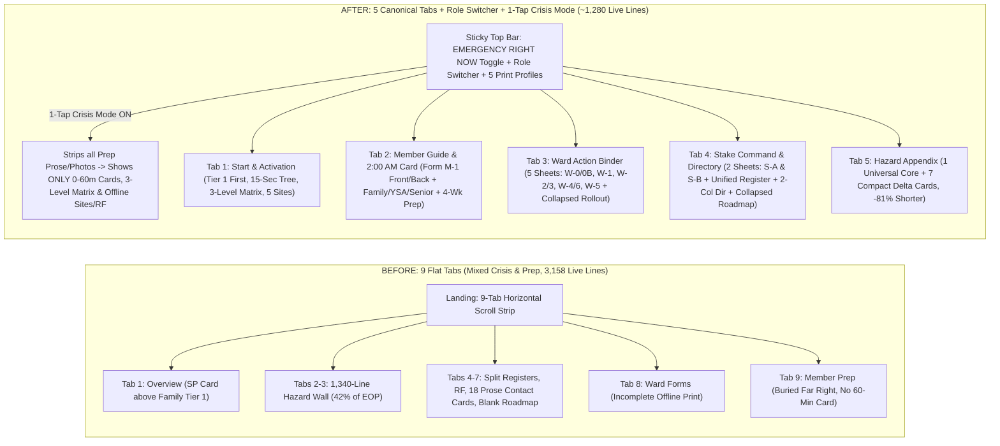
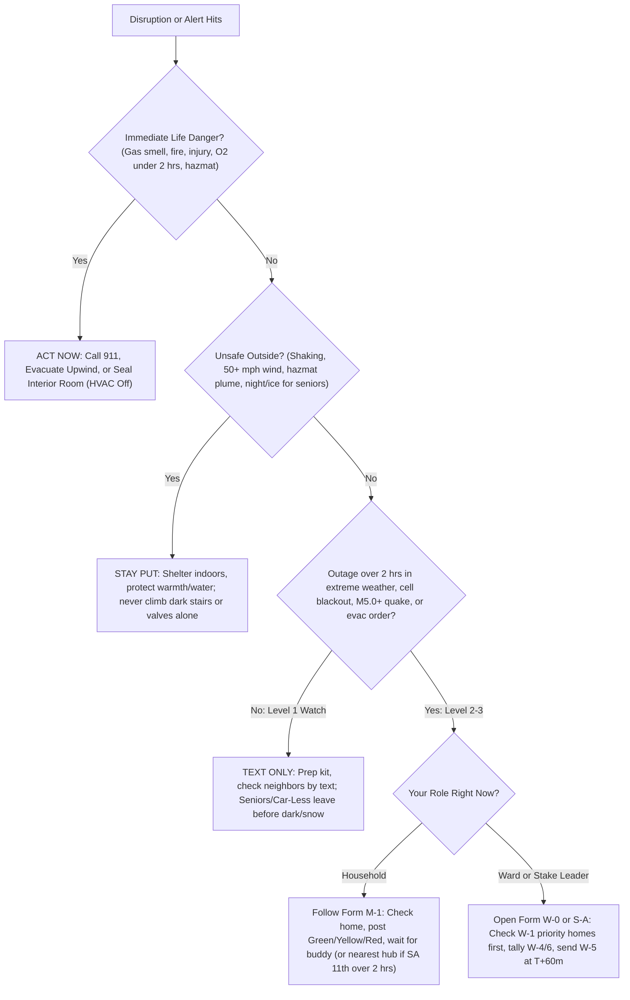
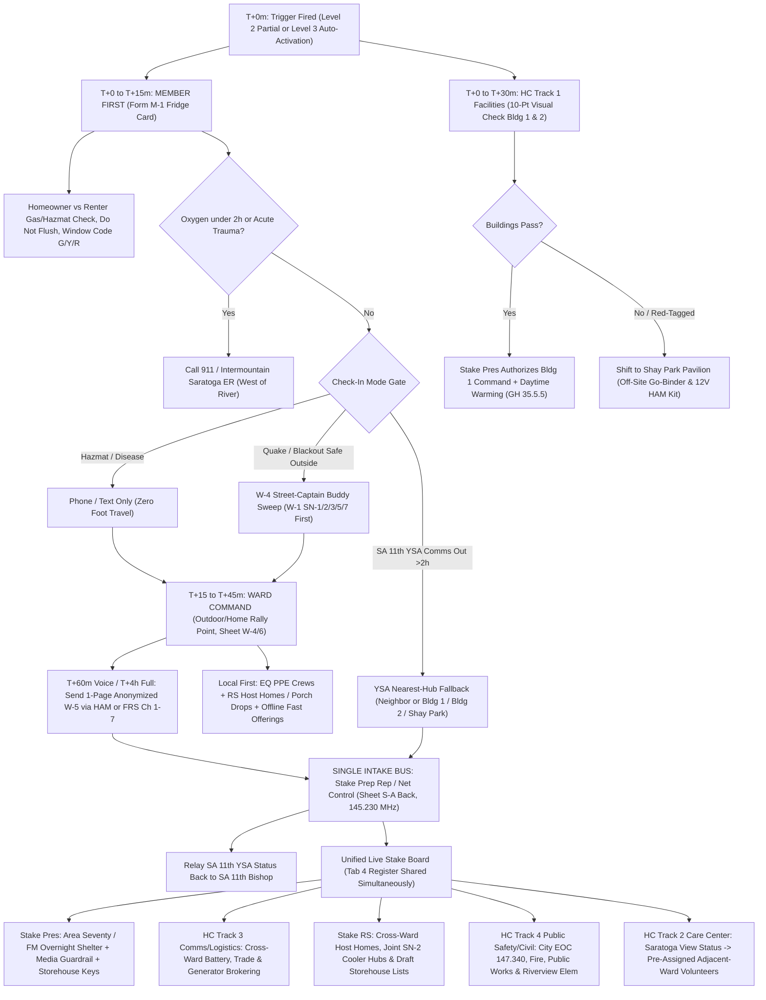
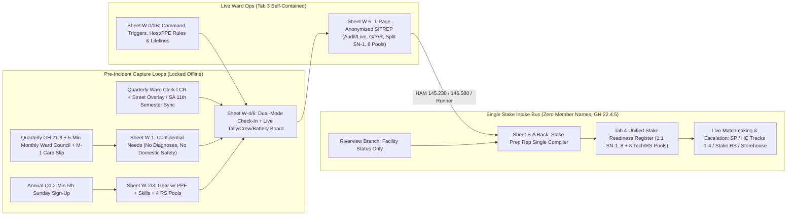

# Crossroads Stake EOP — Simplification, UX, Training & Process Redesign Blueprint

**Audited Baseline:** [stake_leadership_presentation.html](file:///Users/nickallen/code/Emergency%20plan/stake_leadership_presentation.html) (`8,572` HTML lines; `3,158` live text lines across 9 tabs)  
**Input Evidence:** All 10 role audits & Lead Arbitration synthesis in [improvement_recommendations2.md](file:///Users/nickallen/code/Emergency%20plan/docs/improvement_recommendations2.md) (10-Role 2:00 AM Clarity avg: **`2.30 / 5`**; Member cohorts unanimous **`2.00 / 5`**)  
**Specialist Panel:**
1. **UX Designer & Information Architect** (`UX-1`–`UX-8`) — Navigation, Crisis-vs.-Prep modes, WCAG AA/senior accessibility, print profiles.
2. **Trainer & Instructional Designer** (`TR-1`–`TR-8`) — Cognitive load, plain-English rewrites, micro-how-tos, 10-minute onboarding, teaching & drill scripts.
3. **Lead Process & Systems Engineer** (`PE-1`–`PE-8`) — State-machine activation, 1:1 data/form schema parity, single-intake command bus, RF de-confliction, RACI ownership.
4. **Radical Simplifier & Anti-Bloat Editor** (`SM-1`–`SM-8`) — Ruthless subtraction, Cut/Merge/Demote ledger, Universal Core + Hazard Delta compression, hard cap on printable sheets.

---

## Executive Simplification Blueprint (How to Fix 100% of V2 While Cutting Bloat by ~59%)

> **Core Risk Solved:** Blindly adding all V2 P0–P2 fixes (`S-0..S-3`, `W-0B`, `W-6`, `M-1`, Neighbor Care Slip, SA 11th Addendum, Saratoga View Box, checklists) on top of V1's 9 tabs would balloon the document to **~4,100+ live lines and 16+ separate forms**—making 2:00 AM usability *worse*. By pairing **Radical Subtraction** with **Role-First UX**, **Plain-English Job Aids**, and **Lean Single-Bus Processes**, we achieve the opposite:

| Metric | V1 Current | Naive V2 Add-On | **Unified Simplified V2 Target** | Delta vs. V1 |
|---|---:|---:|---:|---:|
| **Navigation Tabs** | 9 flat tabs (horizontal mobile scroll) | 9+ tabs | **5 canonical tabs** + Role Switcher | **-44%** |
| **Live Reading Surface** | `3,158` text lines | `~4,100+` text lines | **`~1,280` live text lines** (Prep in `<details>`) | **-59%** |
| **Tab 2 + Tab 3 Hazard Content** | `1,340` text lines (42% of EOP) | `~1,400+` text lines | **`~260` text lines** (Universal Core + 7 Deltas) | **-81%** |
| **Printable Forms / Sheets** | 9 scattered forms/checklists | 16+ loose sheets | **8 double-sided sheets Stake-wide** (`1M + 5W + 2S`) | **-50% vs. Naive V2** |
| **2:00 AM Mode Separation** | Mixed Crisis + Prep on every tab | Mixed | **1-Tap `EMERGENCY RIGHT NOW` Crisis Toggle** | **Instant 0–60m focus** |
| **Print Profiles** | 2 binary modes (`8.4pt !important`) | Fragmented | **5 Role Print Profiles** (incl. **15pt Senior Large Print**) | **100% self-contained** |
| **V2 Safety & Key Fixes Preserved** | — | 100% | **100% of P0–P2** (zero safety or Handbook loss) | **Full coverage** |

### Unified Target Architecture (5 Tabs + Role Switcher + 1-Tap Crisis Mode)



### The Minimum Viable Print Kit (**8 Double-Sided Sheets Stake-Wide**)
1. **Member Sheet (`1 Sheet`, Front/Back — Form `M-1`, Standard `9.5pt` or Senior `15pt` Large Print):**
   - *Front:* First 60 Minutes (4-row Shelter-vs.-Evacuate + Early-Evac, 6-step offline checklist w/ Homeowner/Renter/Senior branches, `"DO NOT TRY ALONE"`, `"DO NOT FLUSH"`, Green/Yellow/Red, Ward FRS channel, `GH 35.5.5` chapel rule).
   - *Back:* Upgraded Step 7 Contacts (School/Campus/Work, Skyward Backup Pickup, East-of-River Stay-vs.-Walk, Landlord 24/7, Roommate, Renter's Insurance, DME-O2, Primary Children's `(385) 531-1200`, Poison Control `1-800-222-1222`) + 2-Min How-To + cut-off **Voluntary Neighbor Care Slip** (with `GH 22.4.5` confidentiality lock). *(In `15pt` Senior Large Print: Page 1 = Emergency Steps & Contacts; Page 2 = 15pt Meds & Allergies Card.)*
2. **Ward Action Binder (`5 Sheets`, 100% Self-Contained Offline — Tab 3):**
   - **Ward Sheet 1 (`W-0 / W-0B` Front/Back):** Front = Ward Command Summary, Succession, 3-Level Triggers, Outdoor/Home Rally Point, Offline Storehouse/Fast-Offering Box, Lifelines (incl. Utah DV Link `1-800-897-5465` & LDS Family Services); Back = SN-1–8 Definitions, 5-Point Host Checklist (welcoming singles/roommates/pets), Work-Crew/Chainsaw PPE Rules, SA 11th YSA & Riverview Branch boxes.
   - **Ward Sheet 2 (`W-1`):** Confidential Special Needs (`15–20` rows, consent date, checked box; *"domestic safety"* deleted per `GH 38.6.2`; adds HoH/low-vision/landline-only/no-night-driving/car-less/solo).
   - **Ward Sheet 3 (`W-2/3` Front/Back):** Front = Equipment (`PPE On-Hand?`, `Operator-Only vs. Loanable`); Back = Medical/Trades/HAM + 4 RS Pools + Voluntary/No-Obligation Disclaimer.
   - **Ward Sheet 4 (`W-4/6` Front/Back):** Front = Dual-Mode Accountability (LCR Phone-Up vs. 10–12 Geographic Street-Captain Blocks); Back = Reusable Green/Yellow/Red Ward Tally, Work-Crew Dispatch & 3-line Battery-Loan Board.
   - **Ward Sheet 5 (`W-5`):** Strictly 1-page Anonymized Ward → Stake SITREP (`Audit / Live` toggle, 6-box Part 0 Household Tally, split `SN-1 Total / No Aux Power`, 8 Tab-5 parity pools, Single Stake Intake routing).
3. **Stake Command Kit (`2 Sheets`, Front/Back — Tab 4 Off-Site Go-Binder):**
   - **Stake Sheet 1 (`S-A` Front/Back — Stake Pres + Prep Rep/Net Control):** Front = 3-Level Triggers, East-of-River Succession, `GH 35.5.5` & Ordinance Keys, Media/Risk Mgmt Guardrails, Offline Escalation Roster; Back = De-Conflicted RF Table (`FRS Ch 1–7` Wards `Tone 0`, `Ch 8–14` Relays, `145.230` Net / `146.580` Tactical Simplex), Auto-Monitor Triggers, Timed Net Script (`T+60m` / `T+4h`), Shay Park 12V Go-Box Custodian.
   - **Stake Sheet 2 (`S-B` Front/Back — HC 4-Track + Stake RS):** Front = Standardized 4 HC Track Triggers, 2-Deep West-of-River Key/Backup Roster, 10-Pt Pass/Fail Visual Building Checklist & Shutoff Box; Back = Stake RS First-Hour Checklist (FM-cleared Joint SN-2 Hubs, `36–46°F` towel-wrapped cool packs, Draft Storehouse Lists for Bishop/SP keys) + Need → Resource Matchmaking Matrix.

---

## 1. UX Designer & Information Architect Report (`UX-1`–`UX-8`)

### 1.1 Itemized UX Observations

| ID | Observation | Where | Who It Hurts | Root Cause | Severity |
|---|---|---|---|---|---|
| **UX-1** | **9-Tab Flat Nav Cognitive Overload & Mobile Burial** | `<nav class="tabs">` & `.scroll-hint` (`L2575–2597`) | All 10 roles; acutely **Members** (Tab 9 sits off-screen far right) | 9 peer tabs span 3 horizontal-scroll clusters; mobile forces *"Swipe tabs sideways → (Member Prep is Tab 9)"*, maximizing choice paralysis under adrenaline. | **Critical** |
| **UX-2** | **Crisis vs. Preparation Mode Mixing** | Tabs 1, 3, 8, 9 | All 10 roles at 2:00 AM | Every tab interleaves multi-month prep essays, cadence tables, and hero photos *above* or *beside* urgent 0–60 min actions. | **Critical** |
| **UX-3** | **Landing-Page Visual Hierarchy Inversion** | Tab 1 `.quick-cmd-card` (`L2657–2669`) above `.tier-flow` (`L2672`) | **Families, YSAs, Seniors**; **HC, Stake RS, Prep Rep, Bishops** | Highest-contrast navy/gold block is the *Stake President Card* sitting directly above Tier 1 Family Self-Reliance—signaling "internal leader binder" to members while leaving 4 leader roles cardless. | **High** |
| **UX-4** | **Buried Survival & Field Reference Cards** | Tabs 3, 4, 5, 6 vs. Tabs 8 & 9 | **Members** & **Ward Leaders** | Organized by *Church worksheet taxonomy* (Steps 1–3) instead of *operational consumer*, forcing blackout tab-hopping across 2,200+ lines of Tab 3. | **Critical** |
| **UX-5** | **Offline Bookmark & Tap-to-Call Failure Illusion** | `.emergency-strip` (`L2611–2623`), `a2hs-modal` (`L8102`), SW (`L8536`) | **Families, YSAs, Seniors** in blackouts | Red `tel:` pills assume cell service; "Save to Home Screen" omits warning that iOS evicts cached web data, `file://` skips Service Worker registration, and bookmarks fail when towers die. | **Critical** |
| **UX-6** | **Print-Profile Fragmentation & `8.4pt` Lock** | `printCurrentTab()` (`L8397`) & `@media print` (`L2022`) | **Seniors**, **Ward Leaders**, **Stake Leaders** | Only *Full Plan* or *Current Tab* exist. Printing Tab 9 dumps pages of prep prose; Tab 8 drops SN-1–8/Host/PPE/Lifelines; `@media print` hardcodes `body { font-size: 8.4pt !important; }`, wiping out `A+ Larger Text`. | **Critical** |
| **UX-7** | **Senior, Low-Vision & WCAG AA Bugs** | `html.large-text` (`L53`), `.nav-cluster-label` (`L386`), `.subtab-btn` (`L1904` vs `L1974`), modals (`L8063`) | **Seniors (70+)**, low-vision & keyboard users | `.nav-cluster-label` is `10.4px` `#64748b` on `#f1f5f9` (~4.3:1, fails WCAG AA); mobile `.subtab-btn` at `L1974` (`padding: 7px 10px; 0.76rem`) overrides the `44px` touch-target fix at `L1905`; tabs lack `role="tablist"`/`aria-selected`; modals lack focus trapping. | **High** |
| **UX-8** | **Stateless Role Router & Homeowner Bias** | `.audience-router` (`L2626–2644`), Tab 9 Steps 1–8 | **YSAs/Renters**, **Seniors**, **Ward vs. Stake** | Router is a one-time jump link—never persists role/cohort or surfaces tailored senior/renter callouts, so renters hit shutoff/bucket contradictions and seniors wade through trampoline blocks. | **High** |

### 1.2 Sticky Crisis Bar & Role Switcher Wireframe

```text
+------------------------------------------------------------------------------+
| [●] EMERGENCY RIGHT NOW  (1-Tap Crisis Toggle: Off=Prepare | ON=60-Min Only) |
+------------------------------------------------------------------------------+
| Crossroads Stake Emergency Plan   [Print Kit ▾]  [A+ Text]  [Offline Status] |
|                                                                              |
| I AM A:  (•) Member / Household   ( ) Ward Leader   ( ) Stake Leader         |
|          ↳ Tailor view: [ All ] [ Family ] [ YSA / Renter ] [ Senior 70+ ]   |
+------------------------------------------------------------------------------+
| 5-TAB NAV (48px targets — NO horizontal swipe needed on mobile):             |
| [1. Start] [2. Member & M-1] [3. Ward Binder] [4. Stake & Dir] [5. Hazards]  |
+------------------------------------------------------------------------------+
| [OFFLINE NOTICE: Phone links & web bookmarks fail in blackouts. Print Form   |
|  M-1 or save PDF now. Device Offline Cache: ✓ Ready / ! Opened via File]     |
+------------------------------------------------------------------------------+
```

### 1.3 Detailed UX Recommendations (Ready to Implement in Single-File HTML)
- **UX-R1 (Sticky Crisis Bar + Persistent Role Switcher):** Add `<button id="btn-crisis-mode" role="switch" aria-checked="false">EMERGENCY RIGHT NOW</button>` toggling `body.crisis-mode` (pure CSS hides `[data-mode="prep"]`, switches bar to `#991b1b` / `#fef3c7`, pins Role First-Hour Card to `y = 0`). Persist `crossroads_role` / `crossroads_cohort` in `localStorage` and support `?role=&cohort=&mode=crisis` while keeping legacy `?tab=` links working.
- **UX-R2 (5-Profile `@media print` Engine):** Replace the 2 print buttons with a `<details class="print-menu">` dropdown triggering `printProfile(cls)`: `print-profile-m1-std` (`9.5pt`, 1 double-sided sheet), `print-profile-m1-large` (**`15pt !important`** placed *after* base print CSS so it overrides `8.4pt`, single column, thick `2pt` borders, optional Page 2 Meds Card), `print-profile-ward-pack` (5 self-contained sheets, stripping rollout/calendar prose), `print-profile-stake-kit` (2 double-sided sheets `S-A`/`S-B` + Directory), and `print-profile-full`. Stamp `Crossroads Stake EOP v2.0 • Printed [Date]` in print footer.
- **UX-R3 (Auto-Bind `Form M-1` to `localStorage` + Live Offline Status):** Bind `Form M-1` contact slots to the existing `data-save-key` engine so typing once populates both screen and fridge printout. Add live `navigator.onLine` + Service Worker cache indicator and explicit blackout bookmark warning above `.emergency-strip`.
- **UX-R4 (Fix Concrete CSS & Accessibility Bugs):** Delete the conflicting `.subtab-btn` override at `L1974–1977` (restore `min-height: 44px`, `>= 0.85rem`); darken `.nav-cluster-label` to `#334155` (`>= 7:1` contrast) and header buttons to solid high-contrast borders (`>= 8:1`); add `role="tablist"`, `role="tab"`, `aria-selected`, arrow-key navigation, and modal focus-trap/restore; prompt `A+ Larger Text` users with *"Print the 15pt Large-Print Fridge Card?"*
- **UX-R5 (Invert Tab 1 Hierarchy & Split Step 8 Progress):** Move Tier 1 Self-Reliance + 3-Level Activation Matrix above Stake cards on Tab 1. Split Tab 9 Step 8 into two progress bars (`30-Day Quick Wins: 0/10` vs. `Steady Growth: 0/4`) so young families and renters hit rapid early wins.

---

## 2. Trainer & Instructional Designer Report (`TR-1`–`TR-8`)

### 2.1 Itemized Instructional & Cognitive-Load Observations

| ID | Observation | Where | Who It Hurts | Cognitive / Learning Failure & Fix |
|---|---|---|---|---|
| **TR-1** | **Unfiltered Specialist Jargon** | Tabs 1, 3, 4, 5, 8, 9; hidden Glossary modal | Seniors, new leaders, YSAs, parents | Acronyms (`FRS`, `CTCSS`, `HAM`, `LCR`, `SITREP`, `PEX/SharkBite`, `GH 22.9.1.3`, `SN-1–8`, `W-0–W-6`, `WUI`, `WSRM`) exhaust stressed working memory (3–4 chunk limit). **Fix:** *Plain-Label-First Rule* everywhere (plain English first, code in muted parentheses); remove `CTCSS`/`SITREP`/`PEX` from general prose. |
| **TR-2** | **Declarative "What" Without Procedural "How"** | Tab 3 (`2A`, `2E`, `2F`), Tab 9 Steps 1–4, 7 | Parents, renters, seniors | Tells people to isolate water heaters, turn off gas, cool insulin, or pick up kids without 3-step mechanics—causing errors under adrenaline. **Fix:** Embed 35-word **Micro-How-To Callouts** directly on `Form M-1` & Tab 9. |
| **TR-3** | **Step 8 Mixes 5-Min Wins With 12-Month Goals** | Tab 9 Step 8 (14 mixed items) | Tight-budget families, YSAs, seniors | Placing *"1-month emergency fund"* next to *"DST reminder"* stalls users at ~30% and triggers guilt. **Fix:** Split into **Tier A: 30-Day Quick Wins (`\$0–\$20`, 5–15 min)** vs. **Tier B: Steady Growth (6–12 mo)**. |
| **TR-4** | **Zero "10-Minute Onboarding" for High-Turnover Callings** | Tabs 1, 7, 8 | Newly sustained Bishops, EQPs, RSPs, HCs, Ward Specialists, SA 11th YSA | Handing an 8,500-line site to a brand-new leader causes overwhelm and shelving. **Fix:** Add **10-Minute New-Leader Quick Start** boxes to Tabs 3 & 4 + Calling-Release Binder Handoff ritual. |
| **TR-5** | **Missing Visual Decision Tree for "When Do I Act?"** | Tabs 1, 3, 8, 9 | All 10 roles | Prose policy cannot be scanned at 2:00 AM. **Fix:** Pin the **15-Second Decision Tree** (below) + 3-Level Matrix to Tab 1, `S-A`, `W-0`, and `M-1`. |
| **TR-6** | **Tab 3's 7-Scenario Wall Fails Stress Recall** | Tab 3 (`2A–2G`) | All leaders & redirected members | 7 near-identical narratives cause memory interference (mixing Shelter-in-Place vs. Evacuate). **Fix:** Demote to **Hazard Appendix** with Universal Core + 7 Delta Cards + 1-screen Go-vs.-Stay strip. |
| **TR-7** | **Split-Attention Layout Across 4 Tabs** | Tabs 1, 4, 5, 6, 8 | Members & Ward leaders | Violates spatial contiguity—forcing 4-tab jumps breaks working memory and fails in print. **Fix:** Tier 1 above leader cards on Tab 1; self-contained Ward Sheet 1 (`W-0/W-0B`). |
| **TR-8** | **Homeowner & Smartphone Contradictions** | Tab 9 Weekend 1, Steps 4 & 8; Tab 4 `SN-8` | Renters, seniors, deaf/HoH/low-vision | Renter box says *"skip gas wrench"* while Step 8 requires *"shut off gas"*; Weekend 1 assumes smartphone/cloud; `SN-8` drops deaf/HoH & low-vision. **Fix:** Explicit **Homeowner / Renter / Senior** tags + paper/landline parallel track + restore `SN-8`. |

### 2.2 Plain-English Translation & Micro-How-To Table (Top 10 Rewrites)

| Concept / Rule | Confusing Current Text (Before) | Plain-English + Micro-How-To Rewrite (After) |
|---|---|---|
| **RMP Medical Certificate** *(Tabs 4, 9)* | *"On a tight budget (\$0 option)? Enroll today in Rocky Mountain Power's Medical Certificate Program..."* | **Warning — Not Backup Power:** RMP's Medical Certificate only prevents billing shutoffs and gives planned-outage notice. **It does NOT keep power on or prioritize storm repair.** Keep backup oxygen cylinders from your supplier—if reserves drop **under 2 hours, call 911 immediately**. |
| **Chapel Rule (`GH 35.5.5`)** *(Tabs 1, 3, 5)* | *"Coordinate with FM and seek Area Presidency approval before opening any meetinghouse for overnight shelter (GH 35.5.5)."* | **Don't Drive to the Church First:** After a quake or storm, meetinghouses stay closed until inspected and approved by the Stake President (daytime warming) or Area Presidency (overnight). Stay home or with a neighbor/host family until your Ward confirms a building is open. |
| **Green / Yellow / Red** *(Tab 8 → Tab 9)* | *"Report status (Green = Safe, Yellow = Needs Help, Red = Urgent Medical/Danger)."* | **Flag Your Home:** **GREEN** = Safe, 48 hrs water/warmth. **YELLOW** = Safe now, need non-urgent help (low water, spouse across river, insulin warming, no heat). **RED** = Call 911 / Urgent danger (injury, trapped, oxygen <2 hrs, gas leak). Tape colored paper to a front window if phones fail. |
| **Gas & Hazmat: Homeowner vs. Renter** *(Tabs 3, 9)* | *"Tether a non-sparking wrench at your gas meter... avoid basements for heavier-than-air gases."* | **Homeowners:** Shut off gas **ONLY** if you smell rotten eggs, hear hissing, or see the dial spinning—turn valve **¼ turn crosswise** to pipe, exit, call Enbridge (`1-800-767-1689`). **Apartment/Townhome Renters:** Never hunt locked HOA mains—smell gas? **Exit upwind immediately**, alert hallway & landlord, call Enbridge outside. **Basement Renters (Hazmat):** Move to pre-arranged upstairs neighbor/landlord room or turn HVAC off & seal highest interior room with wet towels. |
| **Dual-Season Insulin Safety** *(Tabs 4, 9)* | *"Keep insulated med pouch + frozen gel packs ready for 4+ hr outages."* | **Never Freeze Insulin (Summer OR Winter):** Keep spare insulin at **36–46°F** with a **towel between the vial and cool pack** (direct ice ruins it). In a winter blackout, keep insulin in an interior warm room or inner coat pocket so it won't freeze. *(Most opened, in-use insulin stays safe at room temp up to 28 days—check label.)* |
| **Water Heater & Emergency Toilet** *(Tabs 3, 9)* | *"Isolate your 40–50 gal water heater... observe 'Do Not Flush' and switch to twin-bucket toilets."* | **Save Water Heater:** (1) Turn off gas/breaker to heater; (2) Close cold-water valve on top; (3) Open an upstairs hot tap for air, drain clean water from bottom spigot. **Sewers Out ("DO NOT FLUSH"):** Lift toilet seat, drape **two heavy trash bags** in dry bowl, lower seat to hold bags, add litter/shavings after use, tie & store outside. *(Stable for seniors; fits apartments.)* |
| **School Pickup & River Bridge** *(Tab 9)* | *"School Reunification: Riverview Elementary (385-579-7355)."* | **Weekday Quake Rules:** (1) Add **2 local neighbors** as Authorized Pickups in **Skyward** today (walk-up pickup with Photo ID when roads jam). (2) **Spouse East of Jordan River:** If bridges close, **stay safe where you are** until daylight/police route opens—text your out-of-area relay; walk only if <5 mi, daylight, safe air. |
| **Radio & Net Jargon** *(Tabs 5, 8)* | *"HAM 146.520 MHz Simplex... FRS Ch 1/3/5 (no CTCSS)... submit W-5 SITREP."* | **Walkie-Talkies (No License):** Tune to your Ward channel (`Wards 1–7 = Ch 1–7`, Tone `0`/Off); listen 5 min at **top of every hour (`:00`)**. **HAM:** Hail `146.520`, work Stake simplex (`146.580`). **Ward Update (`Form W-5`):** 1-page headcount slip (no names) sent at **Hour 1** & **Hour 4**. |
| **Policy & Form Codes** *(Tabs 1, 4, 8)* | *"Activate per GH 22.9.1.3... pull LCR districts for W-4... SN-1–8... PEX/SharkBite."* | Always put plain English first: *"Community-wide emergency plan (GH 22.9.1.3)"*; *"Extra-Care Households (SN-1 to SN-8)"*; *"Ward Member Directory (LCR)"*; *"Push-on pipe caps (handy volunteers—Form W-2/3)"*. |
| **Form W-1 Confidentiality Lock** *(Tab 8 → Tab 9)* | *"Collected voluntarily... functional support needs only (GH 22.4.5)."* | **Your Privacy Is Locked Down:** Sharing a care need (oxygen, insulin, hearing/vision help, ride) is 100% voluntary. We record **only what helps us check on you**—never diagnoses. Kept in a locked paper binder with Bishopric/EQ/RS (never emailed/posted) and shredded when you move or leaders change. |

### 2.3 "Do I Act Right Now?" 15-Second Decision Tree (Pin to Tab 1, `S-A`, `W-0`, `M-1`)



### 2.4 Zero-Burnout Onboarding, Tabletop & Teaching Blueprints
- **New Ward Leader (`10 Min Total`):** Min 0–3 read `Ward Sheet 1 (W-0/W-0B)` + 15-Sec Tree (ignore Appendix); Min 3–7 outgoing leader hands over locked binder (`W-0..W-5`), walks `W-1` & `W-4` map, and shreds superseded copies (`GH 22.4.5`); Min 7–10 confirm Ward Clerk quarterly LCR print, 5-min monthly Ward Council `W-1` check, and `W-5` date (Mar 31; SA 11th Aug/Jan/May).
- **New Stake Leader (`10 Min Total`):** Min 0–3 read your half of `Sheet S-A` or `S-B` + verify West-of-River Backup Lead; Min 3–7 verify off-site Go-Binder, mechanical keys/fobs, Shay Park 12V kit custodian, or Saratoga View nursing desk contact; Min 7–10 confirm 3 red-line fences (HC inspect/SP opens `GH 35.5.5`; Bishop Storehouse keys `GH 22.6.1`; SP+Area Comms sole media voice).
- **Annual 60-Min Stake Council Tabletop (Fall; Rotate Quake → Wildfire → Blizzard):** Min 0–5 frame (*no shaming, find friction on paper*); Min 5–15 Inject 1 (`T+0..15m`, SP stranded east of river, building check); Min 15–35 Inject 2 (`T+60m` sample `W-5` slips: SN-1 O2 <2h, SA 11th walk-in, Saratoga View wheelchair request); Min 35–50 Inject 3 (`Hour 6` curveball: Bldg 1 yellow-tagged or TV reporter); Min 50–60 capture **max 3 concrete fixes** with owners. *(Delete Tab 3 2B's conflicting annual Police/Fire drill.)*
- **45-Min 5th-Sunday / Activity Night Teaching Flow (`GH 8.2.1.2` / `9.2.1.2` Safe — Never Replaces 2nd/4th Sunday Lessons):** Min 0–10 hand out printed `Form M-1` (incl. **15pt Large-Print stack**), read D&C 38:30 & 15-Sec Tree; Min 10–25 fill out `M-1` live (pair youth with seniors for Everbridge/landline signup); Min 25–38 3-cohort peer show-and-tell (4 min each: Family Skyward + `\$20` trunk bag + toilet liner; YSA under-bed water + landlord card + SA 11th hub rule; Senior 2.5-gal jug + `\$10` siphon + Neighbor Care Slip); Min 38–45 circle **1 Tier-A Quick Win** + drop optional 2-min `W-2/3` slip at exit.

---

## 3. Process & Systems Engineer Report (`PE-1`–`PE-8`)

### 3.1 Itemized Process & Workflow Observations

| ID | Process Broken | 2:00 AM / Rollout Failure Mode | Root Cause | Lean Engineering Fix |
|---|---|---|---|---|
| **PE-1** | **Activation State Machine & Mode Switches** | Leaders hesitate on zero-warning quakes or send volunteers into >50 mph wind/chlorine plumes; seniors wait 2 hrs while O2 runs out. | Triggers buried in 2,200 lines of Tab 3; Check-In Mode detached from levels. | Pin unified **3-Level Matrix** to Tab 1, `S-A`, `W-0`, `M-1`; authorize Bishop (or EQP+RSP jointly) autonomous Level 2/3 Ward launch while fencing facilities/ordinances behind Stake/Area keys. |
| **PE-2** | **End-to-End Data Pipeline (`W-1/4 → W-6 → W-5 → Tabs 4–5`)** | Scratch-paper Ward tallies; `W-5` lacks live G/Y/R counts & `Audit/Live` toggle; Tab 4 drops SN-1 `w/o Aux Power`; Tab 5 expects 7 pools `W-5` never collects. | Forms drafted independently of downstream Stake tables (no shared data dictionary). | Enforce **1:1 schema parity**: `W-5` gets `[ ] Audit / [ ] Live` toggle, 6-box Part 0 Tally, split SN-1, and 8 parity pools (4 tech + 4 RS); merge reusable Tally/Dispatch/Battery Board onto back of `W-4` (`W-4/6`). |
| **PE-3** | **Dual `W-5` Routing & Blank Tab 7 Ownership** | `W-5` fans out to Stake RS *and* HCs while bypassing Prep Rep/Net Control → duplicates/drops; blank Tab 7 owners pile ~8/12 tasks on HCs. | Multiple intake endpoints instead of single bus; unassigned RACI; inconsistent HC track titles. | **Single-Intake Command Bus:** all 7 `W-5`s → **Stake Prep Rep / Net Control (`S-A` Back)** → one live Master Board shared simultaneously to SP, HCs, Stake RS. Lock 1 owner/process (RACI below). |
| **PE-4** | **RF Channel Collisions & Missing Net Loop** | All 7 Wards + 2 Libraries collide on FRS Ch 1/3/5 inside 1.0 mi; `146.520 MHz` calling freq misused as working channel; no NCS or timed net. | Generic 3-channel FRS plan scaled without RF engineering. | **Wards 1–7 → dedicated FRS Ch 1–7 (`Tone 0`)**; Libraries/Shay Park/Care Center → **Ch 8–14**. Hail `146.520`, work coordinated 2m simplex (`146.580`); `145.230` Stake Net; `147.340` UCARES/EOC. Timed `:00/:30` net (`T+60m`/`T+4h`). |
| **PE-5** | **Physical, Geographic & Leader SPOFs** | Binders/radios locked inside red-tagged Bldg 1; 2:00 PM quake strands leaders east of Jordan River with no succession/key backups; no outdoor Ward rally point. | Plan assumed intact buildings and 100% west-of-river leader presence. | Mandate **off-site Stake Go-Binders** (6 homes) + **12V Shay Park HAM/lighting Go-Box**; publish **2-Deep West-of-River Key/Succession Roster** (`SP → 1st → 2nd → HC staging only`; `Bishop → 1st → 2nd → EQP+RSP jointly`); add Outdoor Rally Point on `W-0`. |
| **PE-6** | **Non-Geographic & Institutional Black Holes** | SA 11th YSA renters invisible on geographic `W-4` sweeps; Care Center HC has no volunteer lift pool; Riverview Branch placed in SN-1–8 `W-5` matrix. | Geographic family workflow forced onto transient YSA ward & licensed care center. | Embed **SA 11th Addendum** (Aug/Jan/May sync, complex pairing, >2h nearest-hub fallback relayed via Stake Command to SA 11th Bishop); pre-assign **2 adjacent Wards** to Saratoga View; change Riverview Branch to **Facility Status Only**. |
| **PE-7** | **Offline Storehouse, Fast Offerings & Key Drift** | Action #10 TBD leaves Bishops with no offline Storehouse path; Tab 6 Storehouse POC blurs `GH 22.6.1`; Tab 3/5 let HCs "open buildings" (`GH 35.5.5`). | Conflated operational support with ecclesiastical priesthood keys. | Hard-code **2-Step Authorization Gate** (*HC Inspects → SP Authorizes Warming / Area+FM Overnight*; *RS/EQ Draft → Bishop Signs Storehouse*); add 4-line **Offline Storehouse & Fast-Offering Box** on `W-0`. |
| **PE-8** | **Maintenance Friction, Churn & Calling-Release Leaks** | Domestic safety logged on `W-1` (`GH 38.6.2`); 10-min `GH 21.3` interviews overloaded; LCR districts ≠ streets; annual Q1 misses pregnancies/widows/YSA; released leaders keep stale `W-1` binders. | Single-channel capture, static annual batching, missing offboarding/version controls. | Delete domestic safety from `W-1`; decouple capture (`GH 21.3` + 5-min monthly Ward Council = `W-1`; 2-min Q1 5th-Sunday = `W-2/3`; Ward Clerk = quarterly LCR + Street Overlay); add mandatory **`GH 22.4.5` Calling-Release Shred Gate** & form version-date footer. |

### 3.2 End-to-End Simplified Operational Diagrams

#### Diagram A: Unified 60-Minute Crisis Workflow (`Member → Ward → Stake → Area/Civic`)



#### Diagram B: Single-Source-of-Truth Data & Form Pipeline (Zero Schema Drift)



### 3.3 Single-Owner Governance Table (1 Accountable Owner Per Process)

| Process | Single Accountable Owner | Supporting Roles | Live Crisis Cadence | Maintenance Cadence |
|---|---|---|---|---|
| **Plan Approval, Keys (`GH 35.5.5`, Ordinances, Media, Area Seventy, Lehi/AF)** | **Stake Presidency** *(1st → 2nd Counselor west of river)* | Area Seventy, FM, WSRM, Stake Clerk | Authorize Level 3, warming hubs, Area/FM overnight, Sunday changes, Storehouse keys | Annual Stake Council review + Lehi/AF check |
| **Building Inspection, Keys/Fobs & Library Kits (Track 1)** | **HC Track 1: Facilities** *(2-deep west-of-river backup)* | Building Reps, FM Group | 10-pt visual check on Bldg 1 & 2; recommend open vs. Shay Park; HVAC dampers | Quarterly library FRS/N95/binder check + Annual FM audit |
| **Saratoga View Care Center & Adjacent-Ward Pool (Track 2)** | **HC Track 2: Care Center** *(2-deep backup)* | Riverview Branch Pres, 2 Pre-Assigned Wards | Verify facility status; dispatch pre-assigned adjacent-ward lift/sentry pairs under nurse direction | Semi-annual Executive Director / DON sync |
| **Cross-Ward Heavy Gear, Trades & Shay Park Mobile Kit (Track 3)** | **HC Track 3: Comms & Logistics** *(2-deep backup)* | Stake Prep Rep, Ward EQPs | Broker cross-ward batteries, generators, plumbers, plows, and chainsaw crews | Semi-annual Shay Park 12V Go-Box check + Annual group buy |
| **City EOC, Fire/Police, Public Works & Riverview Elem (Track 4)** | **HC Track 4: Public Safety & Civil** *(2-deep backup)* | Stake Pres, Riverview Principal | Relay Fire/Police corridors, Hazmat All-Clear, boil-water clearance, school lockdown | Annual non-binding City EOC & Principal sync |
| **Stake Welfare, Host Homes, Joint SN-2 Hubs & RS Orientation** | **Stake RS President** | Stake RS Counselors, Ward RSPs, HC Track 3 | Coordinate cross-ward host homes (incl. singles/pets), FM-cleared Joint SN-2 hubs, draft Storehouse lists | Annual Stake RS Orientation (`GH 9.6`) + Q1 RS pool review |
| **Single `W-5` Intake Bus, HAM Net Control & Version Sync** | **Stake Emergency Prep Rep (`GH 22.9.4`)** | Backup NCS, Ward Specialists | Open `145.230 MHz` Net on trigger; ingest all 7 `W-5`s + YSA relays at `T+60m`/`T+4h` | Quarterly 15-min HAM Net + Annual Q1 `W-5` rollup & binder date stamp |
| **Ward Command, Autonomous Level 2/3 & Storehouse/Fast Offerings** | **Bishop** *(1st → 2nd → EQP+RSP jointly)* | Bishopric Counselors, Exec Sec | Open Ward Command at rally point; offline Storehouse/fast-offering relief (`GH 22.6.1`); `GH 38.6.2` | Quarterly Ward Council + Calling-Release Shred Verification |
| **Physical Sweeps, Work-Crew PPE & Heavy Gear (`W-2/3`, `W-4/6`)** | **Elders Quorum President** | EQ Counselors, Ward Specialist | Co-lead W-4 sweeps, dispatch 2-person PPE crews, haul SN-1 batteries & SN-2 coolers | Quarterly `GH 21.3` `W-1` check + 5-min monthly Ward Council refresh |
| **Vulnerable Care, Host/Porch Drops & Emotional Care (`W-1`, `W-4/6`)** | **Ward RS President** | RS Counselors, RS Service/Activities Coord (`GH 9.3.3`) | Prioritize `W-1` SN-1/2/3/5/7, match host homes/porch drops, care for families/seniors/singles | Quarterly `GH 21.3` `W-1` check + 5-min monthly rolling refresh |
| **LCR Street Overlay, Move-Ins & Binder Offboarding** | **Ward Clerk** | Exec Sec, EQ/RS Secretaries | Maintain offline household headcount baseline for `W-4/6` accountability | Quarterly LCR print, move-in flag, calling-release binder audit |
| **Ward Logistics, `W-2/3` Sign-Up, `W-5` Drafting & Radios** | **Ward Welfare Specialist (`GH 22.6.4`)** | Ward HAM Operator | Assist EQP/RSP on `W-4/6`; transmit `W-5` to Stake Net Control; track loaned batteries | Annual Q1 2-min 5th-Sunday `W-2/3` sign-up + Quarterly binder/radio check |

---

## 4. Radical Simplifier & Anti-Bloat Editor Report (`SM-1`–`SM-8`)

### 4.1 Itemized Anti-Bloat & Subtraction Observations

| ID | Current Bloat / Duplication | Cost to Users | Ruthless Simplification |
|---|---|---|---|
| **SM-1** | **Tab 3's 7-Playbook Copy-Paste Monster (`1,111` text lines = 35% of EOP)** | Buries life-safety deltas (`"Do Not Flush"`, HVAC off, `<25 mph` wind, Work Crew PPE) under 7 repeated scenarios, 7 repeated 11-row mini-matrices, and 28 repeated boilerplate blocks. | Replace Tabs 2 + 3 with **Tab 5: Hazard Appendix** built on **1 Universal Core + 7 Compact Delta Cards** (`1,340 → ~260` lines, **-81%**). |
| **SM-2** | **V2 Form Proliferation Threat (`16+` loose forms/cards)** | Unpaid volunteers will never print, sync, or hand off 16+ loose sheets—guarantees binder rot by Q2. | Hard cap of **8 double-sided printable sheets Stake-wide** (`1 Member` + `5 Ward` + `2 Stake`) via front/back pairing. |
| **SM-3** | **Practice Cadence Repeated Verbatim 3× (Tabs 7, 8, 9)** | Maintenance drift and scroll tax on every tab. | **Single-Owner Rule:** Family cadence only in Tab 2 (3 bullets); Ward calendar in Tab 3 `<details>` drawer; Stake cadence in Tab 4 `<details>` drawer. Delete Tab 7's 3-column recap grid. |
| **SM-4** | **Hazards Repeated 4× (Tabs 1, 2, 3, 9)** | Contradictions creep in (Blizzard Facilities `—` vs. warming hub; bare 5-gal buckets). | Keep **1** canonical 7-row Hazard Table (Tab 5) + **1** 4-row Shelter-vs.-Evacuate box (`Form M-1`). Delete Tab 1's *3 Realities*, Tab 2's 7×11 grid, all seven 11-row Tab 3 mini-matrices, and Tab 9 Step 4's redundant hazard table. |
| **SM-5** | **Contacts & 5 Sites Scattered Across 6 Tabs + 18 Repeated HC POC Lines** | Blackout tab-hopping; Primary Children's & Poison Control trapped away from parents. | Make Tab 4 Directory the single full master (compact 2-col table, **-40%**); keep only 6-line role-scoped lifeline strips on `M-1`, `W-0`, and `S-A`. |
| **SM-6** | **6× Policy & Definition Echo Chamber** | Zero Storage (5×), Ministering First (4×), `GH 22.4.5` (4×), Saratoga View (5×), `GH 35.5.5` (4×), SN-1–8 (5×) train readers to skim past real safety warnings. | State each policy **once in full** at its authoritative home; everywhere else use a **1-line bold guardrail**. |
| **SM-7** | **Duplicate Blank `[ ___ ]` Stake Matrices (Tabs 4 & 5) + 11 Tab 1 Widgets** | 220+ lines of empty brackets across two tabs; Stake leaders flip tabs to match needs to pools. | Merge Tabs 4 + 5 into **1 Unified Stake Readiness Register** (SN-1–8 left, Voluntary Pools right); trim Tab 1 to 5 clean blocks. |
| **SM-8** | **Prep Prose Blocking 2:00 AM Screens (Tabs 7, 8, 9)** | Bishops scroll past 180 lines of crafts/calendars to reach `W-0`; Tab 9 repeats water/boil rules 7×; `M-1` would duplicate Step 7 unless merged. | **Crisis Top, Prep Collapsed:** Pin `M-1` top of Tab 2, `W-0` top of Tab 3, `S-A` top of Tab 4; tuck rollout/calendars/roadmap inside `<details>` drawers; merge `M-1` + Step 7 onto 1 front/back sheet. |

### 4.2 Master Cut / Merge / Demote / Keep Ledger

| Item / Section | Verdict | Consolidation Target | Est. Reduction |
|---|---|---|---|
| **Current V1 Tabs** | | | |
| Tab 1: Overview (`179 L`) | **KEEP (TRIM)** | **Tab 1: Start & Activation** (Tier 1 above Leader router; 15-Sec Tree + 3-Level Matrix; cut 3 Realities & duplicate prose) | **-35%** (`~115 L`) |
| Tab 2: Hazards (`229 L`) + Tab 3: Disruptions (`1,111 L`) | **MERGE + DEMOTE** | **Tab 5: Hazard Appendix** (Universal Core + 7 Delta Cards; **CUT** 7×11 grid, 7 repeated scenarios, seven 11-row mini-matrices) | **-81%** (`~260 L` combined) |
| Tab 4: Special Needs (`232 L`) + Tab 5: Resources (`211 L`) | **MERGE** | **Tab 4: Stake Command** (1 Unified Stake Readiness Register; Need→Resource + RF on `S-A`/`S-B`; Host/PPE moved to `W-0B`) | **-50%** (merged) |
| Tab 6: Directory (`118 L`) | **MERGE** | **Tab 4: Stake Command** (compact 2-col table; strip 18 repeated HC POC lines; add LDSFS, DV Link, Aging, UTA/UDOT) | **-40%** (`~70 L`) |
| Tab 7: Actions & Cadence (`138 L`) | **DEMOTE TO DRAWER** | **Tab 4 `<details>` Drawer** (assigned 12-item roadmap + Stake cadence only; **CUT** Family/Ward duplicate cadence boxes) | **-100% live** (`~95 L` collapsed) |
| Tab 8: Ward Toolkit (`476 L`) | **KEEP (RESTRUCTURE)** | **Tab 3: Ward Action Binder** (5 Forms on top; 90-day + 4-Qtr + Grab-and-Go tucked in `<details>` drawer) | **-45% live** (`~260 L` live) |
| Tab 9: Member Prep (`413 L`) | **KEEP (PROMOTE & TRIM)** | **Tab 2: Member Guide** (Pin `M-1` at top; kill 7× water/shutoff repetition; **CUT** Step 4 7-row hazard table) | **-29%** (`~295 L` incl. `M-1`) |
| **Proposed V2 Additions** | | | |
| `Form S-0` (SP) + `Form S-3` (Prep Rep / NCS) | **MERGE** | **Stake Sheet 1 (`S-A` Front/Back):** Front = SP Command/Keys/Succession; Back = RF/Net Script/Offline Roster | **2 → 1 sheet (-50%)** |
| `Form S-1` (HC 4-Track + 10-pt + Shutoff) + `Form S-2` (Stake RS) | **MERGE** | **Stake Sheet 2 (`S-B` Front/Back):** Front = HC 4-Track + 10-Pt Building Check + Key/Shutoff Box; Back = Stake RS + Matchmaking | **4 → 1 sheet (-60%)** |
| `Form W-0` + `Form W-0B` (Field Ref) + SA 11th / Riverview Addenda | **MERGE** | **Ward Sheet 1 (`W-0 / W-0B` Front/Back):** Front = Command/Triggers/Rally/Storehouse/Lifelines; Back = SN-1–8/Host/PPE/YSA/Riverview | **4 → 1 sheet (-55%)** |
| `Form W-1` (Special Needs) | **KEEP (UPGRADE)** | **Ward Sheet 2 (`W-1`):** 15–20 rows, consent/checked; **CUT** *"domestic safety"*; add HoH/low-vision/car-less/solo | **Net 0%** (safer) |
| `Form W-2` (Gear) + `Form W-3` (Skills + 4 RS Pools) | **MERGE** | **Ward Sheet 3 (`W-2/3` Front/Back):** Front = Gear (`PPE?`, `Loanable?`); Back = Trades/Med/HAM + 4 RS Pools + Disclaimer | **2 → 1 sheet (-40%)** |
| `Form W-4` (Districts) + `Form W-6` (Tally/Crew/Battery Board) | **MERGE** | **Ward Sheet 4 (`W-4/6` Front/Back):** Front = LCR vs. 10–12 Street Blocks; Back = Reusable G/Y/R Tally, Crew Dispatch & Battery Log | **2 → 1 sheet (-45%)** |
| `Form W-5` (Ward → Stake SITREP) | **KEEP (UPGRADE)** | **Ward Sheet 5 (`W-5`):** Strictly 1 page (`Audit/Live`, 6-box G/Y/R, split SN-1, 8 parity pools, single intake) | **Net 0%** (1 page) |
| `Form M-1` (+ 15pt View) + Step 7 Card + Neighbor Care Slip | **MERGE** | **Member Sheet 1 (`M-1` Front/Back):** Front = First 60 Min; Back = Step 7 Contacts + 2-Min How-To + Cut-Off Care Slip | **3 → 1 sheet (-60%)** |
| Saratoga View Residents & Adult Children Box | **KEEP (COMPACT)** | **4-line Callout in Tab 2 (Member Guide)** | `~10 lines` |
| Tabletop Script & Quarterly Radio/Battery Log | **DEMOTE TO DRAWER** | **Compact checklist inside Tab 4 Roadmap `<details>` Drawer** (no separate printable forms) | **-80%** |

### 4.3 Proof of Compression: The "Universal Core + 7 Hazard Deltas" Pattern (`-83%` on Tab 3)

**Every-Emergency Universal Core *(Read Once — Applies to All 7 Hazards)*:**
- **Before:** 72-hr kits, 14 gal/person water, 2-wk rotating pantry, 2–3 wk Rx buffer, Everbridge, Member Tools. Wards maintain `W-1` (quarterly `GH 21.3` + 5-min monthly Ward Council), `W-2/3` (Q1 5th-Sunday), `W-4` street blocks. Stake runs quarterly FRS/HAM nets, keeps off-site Go-Binders + Shay Park 12V kit, holds 1 annual 60-min tabletop.
- **0–72 Hours:** **Family First** → Check-In Mode per 3-Level Matrix → `W-1` priority (`SN-1, 2, 3, 5, 7`) → local match via `W-2/3` → anonymized `W-5` at `T+60m`/`T+4h` → HC 10-pt building check before entry; SP approves warming (`GH 35.5.5`), Area Pres+FM overnight; west-of-river trauma → Intermountain ER `(801) 763-3500`.
- **1–2 Weeks & Recovery:** 2-wk stores & safe outdoor cooking; daily ministering; EQ+RS host homes/porch drops; Bishops order from Saratoga Springs Storehouse `(801) 436-8205` (`GH 22.6.1`); photo damage, scam alerts, LDS Family Services grief care, annual after-action update.

**The 7 Compact Hazard Deltas *(Unique Rules Only)*:**
1. **Earthquake (Wasatch M7.0+ | Auto Level 3):** Gas OFF only if smelled/hissing (renters: evacuate upwind); isolate water heater; `"DO NOT FLUSH"` → existing-toilet double-liner; East-of-River Stay-vs.-Walk bridge rule; inspect Bldg 1 & 2 → shift Command/LZ to **Shay Park** if red-tagged; ER & Storehouse west of river only.
2. **Wildfire (Lake Mountain WUI | 15–60 min):** 15-min north evac (**SR-73 / Pioneer Crossing**); HVAC off, N95s, pets/carriers; **Seniors/Car-Less Early-Evac on Watch**; door-knock `W-1` rides; HC Care Center dispatches pre-assigned adjacent-ward wheelchair pairs to Saratoga View; SP activates Lehi/AF host housing; watch 2–3 yr burn-scar flash floods.
3. **Winter Blizzard & Grid Freeze (<32°F | 3–7 days):** Forced-air furnaces fail without power → consolidate to **1 warm room**; generators 20+ ft outside (**CO lethal**); trickle/drain pipes at 35°F; **protect insulin from freezing**; twice-daily checks; SP opens powered/FM-cleared warming hub; Harvest Hills fallback for Saratoga View; thaw-day PEX plumber crews.
4. **High Windstorm (70–90+ mph | 6–24h):** 15" trampoline augers; indoors >50 mph; avoid Redwood Rd alkaline dust; **35+ ft from downed 7,200V lines** (RMP + 911); **Work Crews stand down until gusts <25 mph**; enforce chainsaw/roof/youth PPE rules.
5. **Hazmat Plume (SR-68 / Redwood Rd | 0–5 min):** **HARD SHELTER-IN-PLACE** (never drive to Riverview Elementary); HVAC/exhaust OFF, wet towels + 4–6 mil plastic in upper/interior room (basement renters: upstairs landlord room or seal highest interior room); exposure = strip/flush 15 min + Poison Control `1-800-222-1222`; **remote-only Ward checks**; HC shuts building air-handlers; cross-ventilate 30 min after All-Clear.
6. **Culinary Water Failure (3–14 days):** **3-min rolling boil** (4,500 ft) or 8 drops bleach/gal; **NEVER drink untreated Utah Lake secondary water**; isolate water heater; priority water drops to `SN-7` (formula) & `SN-4` (dialysis); Public Works Urgent `(801) 404-2468`; Bishops/SP stage Storehouse water pallets; flush cold taps 5+ min after clearance.
7. **Widespread Disease (4–12 weeks):** Sick-room kit (`SpO2 <92%` → ER); 1-mo cash buffer; solo adults pre-pick text "sick-day buddy"; **contactless porch drops only**; zero visits to Saratoga View; SP/Area Seventy authorize worship pause & home sacrament (`GH 29.2.1.1`/`29.5`).

### 4.4 The 6 "Stop-Bloat" Guardrails for Implementation
1. **One-In, Two-Out Line Budget:** Keep total live reading surface **under `1,500` text lines** (vs. `3,158` in V1).
2. **Hard Cap of 8 Printable Sheets Stake-Wide:** No new standalone form—every addendum merges onto the back or footer of `M-1`, `W-0/0B`, `W-2/3`, `W-4/6`, `W-5`, `S-A`, or `S-B`.
3. **Single Source of Truth:** State each policy, phone table, and cadence block **once in full**; everywhere else use a **1-line bold guardrail**.
4. **Crisis Above the Fold; Prep in `<details>`:** Minutes 0–60 cards sit at `y = 0`; rollout checklists, calendars, activity ideas, and the 12-item roadmap live inside collapsed `<details>` drawers.
5. **Universal Core + Delta Only:** Max 6–8 unique bullets per hazard card.
6. **Physical Print-Profile Verification Gate:** Before shipping V2, verify every Print-CSS profile (`M-1` Std = 1 sheet, `M-1` 15pt Large Print = 1–2 pages at true `15pt`, Ward Binder = 5 sheets, Stake Command Kit = 2 sheets) with zero overflow or `8.4pt` overrides.

---

## 5. Unified Execution Plan (Implementing Simplification + V2 P0–P2 Together)

| Phase | Scope & Concrete Deliverables in [stake_leadership_presentation.html](file:///Users/nickallen/code/Emergency%20plan/stake_leadership_presentation.html) | Eliminates / Fixes |
|---|---|---|
| **Phase A: Architecture, CSS & Print Engine** *(Foundation)* | Collapse 9 tabs → **5 canonical tabs** (`Start`, `Member & M-1`, `Ward Binder`, `Stake & Directory`, `Hazard Appendix`); add **Sticky `EMERGENCY RIGHT NOW` Crisis Toggle** (`body.crisis-mode`), **Persistent Role/Cohort Switcher**, **5 Print-CSS Profiles** (fixing the `8.4pt !important` lock for 15pt Senior print), and WCAG AA / `44px` touch-target / ARIA / modal focus fixes. | `UX-1`–`UX-8`, `SM-2`, `SM-8` |
| **Phase B: P0 Safety, Keys, RF & Data Fixes** *(Mandatory)* | Delete *"domestic safety"* from `W-1` (`GH 38.6.2`) + add Utah DV Link `1-800-897-5465`; rewrite **RMP Medical Certificate** (`O2 <2h → 911` + DME cylinders); dual-season **insulin** (`36–46°F` towel-wrapped; no winter freeze) + Medicare Part D tips; fix **`SN-8`** deaf/HoH/low-vision; multi-unit gas/basement hazmat + **existing-toilet double-liner**; **Priesthood key fences** (`GH 35.5.5`, `22.6.1`, SP/Ward succession, Media/Risk Mgmt, Riverview Facility-Only); **de-conflicted RF** (`FRS Ch 1–7` Wards `Tone 0`, `Ch 8–14` Relays, `146.580` 2m working simplex); fix Tab 2 Blizzard Facilities `—`. | All V2 P0 items, `PE-1`, `PE-4`, `PE-7`, `TR-2` |
| **Phase C: Build the 8 Double-Sided Sheets & Single Data Bus** *(2:00 AM Clarity)* | Build **Member Sheet `M-1`** (Front/Back, auto-bound to `localStorage`, 15-Sec Tree, Skyward pickup, Stay-vs.-Walk bridge rule, Primary Children's/Poison Control, Landlord/Roommate/DME, Cut-Off Care Slip); **5 Ward Sheets** (`W-0/0B` w/ SA 11th & Offline Storehouse, `W-1`, `W-2/3`, `W-4/6`, 1-page parity `W-5`); **2 Stake Sheets** (`S-A`, `S-B` w/ 10-Pt Building Check & 2-Deep West-of-River Roster); Unified Tab 4 Readiness Register + Compact 2-Col Directory. | All V2 P1 items, `PE-2`, `PE-3`, `PE-5`, `PE-6`, `TR-1`, `TR-5`, `SM-5`, `SM-7` |
| **Phase D: Compression, Onboarding & Governance Polish** *(Zero Bloat)* | Compress Tabs 2+3 into **Universal Core + 7 Hazard Deltas** (`-81%`); move rollout/calendars/roadmap into collapsed `<details>` drawers; assign **1 RACI owner** to every Tab 7 item + Area Seventy/Lehi–AF/Bishops' Council/Stake RS Orientation/2 Adjacent Saratoga View Wards; add **10-Min New-Leader Quick Starts**, **60-Min Tabletop Script**, **Calling-Release Shred Gate (`GH 22.4.5`)**, **Saratoga View Residents Box**, Everbridge URL + landline track, and split Step 8 (**30-Day Quick Wins** vs. **Steady Growth**). | All V2 P2 items, `PE-8`, `TR-3`, `TR-4`, `TR-6`, `TR-8`, `SM-1`, `SM-3`, `SM-4`, `SM-6` |
