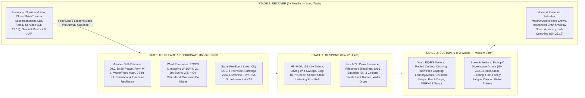

# Crossroads Stake EOP — V2 Depth, Compassion, Recovery & 11-Disruption Review (`simplification2.md`)

**Comparison Baseline:** [stake_leadership_presentationV2.html](file:///Users/nickallen/code/Emergency%20plan/stake_leadership_presentationV2.html) (`2,331` lines) vs. V1 [stake_leadership_presentation.html](file:///Users/nickallen/code/Emergency%20plan/stake_leadership_presentation.html) (`8,571` lines)  
**Triggering Critique:** V2 became genuinely strong on immediate `0–60 min` emergency support and offline printability, **but over-compressed the peacetime, ministering, and recovery heart of the plan**—dropping the 4 time horizons (`Before` · `0–72h` · `1–2 wks` · `2+ mo`), erasing the **11 official Church Disruption Categories**, burying pre-event coordination in collapsed drawers, thinning member self-reliance, and making Tabs 3–4 feel like a cold facility-check and headcount-tally binder rather than Christlike EQ & RS ministering.  
**5-Agent Review Panel:**
1. **Relief Society Presidency Reviewer** *(NEW — Tone, Compassion, Christlike Ministering & Gospel Self-Reliance)*
2. **UX Designer & Information Architect**
3. **Trainer & Instructional Designer**
4. **Lead Process & Systems Engineer**
5. **Radical Simplifier** *(Candid Self-Audit: Muscle vs. Fat)*

---

## Executive Diagnosis: The "Thin Core, Rich Appendix" Two-Speed Principle

All 5 agents unanimously confirmed the user's insight: **an Appendix, Pre-Event Preparation Guide, Ministering Playbook, and Multi-Month Recovery Guide *should* be more verbose, warm, and illustrative than a 2:00 AM Crisis Card.**

Because V2 already built a **1-Tap Crisis Mode toggle** (`data-mode="crisis"` vs. `data-mode="prep"`) and **5 Role-Tailored Print-CSS profiles**, restoring rich depth, gospel warmth, all 11 disruption categories, and 4-horizon recovery adds **zero seconds of friction at 2:00 AM** and **zero extra pages to the 8 printable crisis sheets** (`1 Member` + `5 Ward` + `2 Stake`).

### What Stays Cut (Fat) vs. What Must Be Restored (Muscle)

| **FAT — Keep Permanently Deleted** | **MUSCLE — Restore With Warm, Illustrative Depth** |
|---|---|
| Repeating identical 4-horizon boilerplate word-for-word 7× across `2A–2G` | **Structured 4-Horizon Universal Core** (`Before`, `0–72h`, `1–2 Wks`, `2+ Mo`) + **7 Expandable 4-Horizon Hazard Playbooks** in Tab 5 |
| Seven repetitive 11-row mini-matrices buried inside each hazard | **One clean Official 7 × 11 Church Disruption Matrix (Worksheet 1)** grouped into 4 human-centered clusters + interactive filter chips in Tab 5 |
| 16+ loose printable forms & duplicate `W-2`/`W-3`/`W-6`/`S-0..S-3` sprawl | Keep the **8 double-sided Crisis Sheets Cap** strictly intact (`M-1`, `W-0/0B..W-5`, `S-A/S-B`) |
| 6× repeated policy boxes, 3× duplicate cadence grids, 18 repetitive HC POC cards | Keep Single-Source policy guardrails, Tab 4's unified Register & compact 2-col Directory |
| Hiding pre-event coordination & EQ/RS ministering inside collapsed gray drawers | **Visible, open `data-mode="prep"` sections** for Gospel Framing, Member Self-Reliance, Pre-Event Coordination, and **EQ & RS Ministering Across 4 Horizons** (still vanishing in 1 tap when Crisis Mode is ON!) |
| Cold military/IT EOC labels (`SITREP`, `Single Intake Bus`, `Injects`, `Tally Board`) | **Warm, plain-English Church labels** (`Ward Care & Status Update`, `One Shared Stake Listening Post`, `Ward Care & Helping Hands Board`) |

---

## 1. Restoring the Full 4-Horizon Lifecycle & All 11 Church Disruption Categories

### 1.1 End-to-End 4-Horizon Process Model

### 1.2 All 11 Official Church Disruption Categories Mapped to 4 Horizons & Practical Ministering

*Grouped into 4 intuitive teaching clusters so Stake & Ward Councils can audit blind spots in calm weather without getting lost in an 11-item compliance wall (and explicitly spotlighting **#6 Emotional & Spiritual Care**, which spans all 7 local hazards):*

| Cluster | # | Official Church Disruption Category | Before (Prep & Coord) | Short-Term (0–72 Hrs) | Medium-Term (1–2 Wks) | Long-Term Recovery (2+ Mos) | Primary Caregivers |
|---|---|---|---|---|---|---|---|
| **A. Stay Alive & Healthy** | **2** | **Physical Safety** | Anchor water heaters/trampolines; clear wildfire brush | Gas safety/upwind evac; 2-person PPE debris/tarp crews | Fence/yard hazard clearing; post-fire sandbagging | Permanent repairs; widow contractor-scam defense | Household → Ward EQ → HC Track 3 |
| **A. Stay Alive & Healthy** | **8** | **Medical Services** | DME O2 cylinders; Part D buffers; 15pt Meds Card | `<2h O2 → 911`; West-of-River ER; SN-2 `36–46°F` coolers | Rx/clinic continuity; pulse-oximeter loans; senior med checks | Restock sick-room kits; respiratory/follow-up care | Household → Ward RS/EQ → HC Track 4 |
| **A. Stay Alive & Healthy** | **6** | **Emotional & Spiritual** *(All 7 Hazards)* | **Emotional Resilience groups (`GH 22.13`); covenant friendships** | **Calm presence, prayer, priesthood blessings (`GH 18.14`), holding kids, `988`** | **Daily calls to solo seniors/YSAs; authorized home sacrament; host-family check-ins** | **Long-haul grief/PTSD visits; remembering anniversaries; LDS Family Services** | **Bishop, Ward & Stake RS + EQ** |
| **B. Keep Homes Livable** | **3** | **Shelter & Clothing** | 72-hr go-bags; renter Loss-of-Use ALE; Lehi/AF links | Warm-room consolidation; Ward private host homes (incl. singles/pets) | Cross-ward / Lehi–AF billeting; DI clothing orders; laundry swaps | Lease/rebuild navigation; Saturday mold/drywall crews | Household → Ward/Stake RS → SP (`35.5.5`) |
| **B. Keep Homes Livable** | **7** | **Heating & Cooling** | Winterize pipes; CO alarms; MERV-13 filters; warm-room kit | Interior warm room; strict CO safety; clear snow vents | Shared wood-stove/generator homes; senior post-smoke filter swaps | Pipe insulation/heat tape; fall winterization night | Household → Ward EQ/RS → HC Track 3 |
| **B. Keep Homes Livable** | **9** | **Power Sources** | Aux battery sizing; voluntary `W-2/3` power station pool | SN-1 battery-loan dispatch (logged on `W-4/6`) | Rotating charging hubs; safe generator fueling/sharing | Test/upgrade backup power; fall CPAP/battery demo | Household → Ward EQ → HC Track 3 |
| **B. Keep Homes Livable** | **10** | **Sewer & Water** | 14 gal/person + pet water; siphon pumps; liner kit | "Do Not Flush" toilet liners; 3-min boil; SN-4/7 drops | City water trailers / Storehouse water; cold-line flushing | Replace sediment filters; close 2-week home water gap | Household → Ward EQ/RS → HC Track 4 |
| **C. Feed & Move People** | **1** | **Food, Water & Cooking** | 2-wk rotating pantry; Home Storage Center group trips | No-cook / thawed-freezer meals; safe outdoor cooking | Pooled neighborhood outdoor kitchens; hot-soup drops; Storehouse orders (`22.6.1`) | Restock pantry gradually without debt; Personal Finances classes | Household → Ward RS/EQ → Bishop |
| **C. Feed & Move People** | **11** | **Transport & Fuel** | Commuter/campus go-bags; pre-assigned SN-3/car-less rides | Stay-vs.-Walk bridge rule; Saratoga View wheelchair pairs | 4WD plow/snow-shoveling crews; shared errand/Rx/store runs | Culvert/debris clearing; update evac routes | Household → Ward EQ → HC Track 2/4 |
| **D. Coordinate & Gather** | **4** | **Church Facilities** | Annual FM gas/HVAC/generator audit; 2-deep west-of-river keys | 10-pt visual pass; Shay Park shift if red-tagged | Daytime warming/charging/cooler hubs (`GH 35.5.5`); FM sanitization | Structural/FM repairs; phased return to normal worship | HC Track 1 → Stake Pres + FM |
| **D. Coordinate & Gather** | **5** | **Communication** | Everbridge (cell + landline); quarterly HAM/FRS nets | FRS Ch 1–7, `145.230 MHz` Net, loving `W-4` foot sweeps | Daily T+12h updates; large-print paper flyers for HoH/seniors | Update Member Tools, `W-1`/`W-4`, & contact sheets | Stake Prep Rep → Ward Clerk/Spec |

---

## 2. Specialist Panel Findings

### 2.1 Relief Society Presidency Reviewer — Tone, Compassion & Christlike Ministering (`RS-1`–`RS-5`)

> *"Headcounts tell a Bishop where needs are; **Elders Quorum and Relief Society ministers are how the Savior reaches them.** In trimming V1 down, V2 accidentally trimmed out the Savior's heartbeat."*

#### Tone & Framing Rewrites (From Cold EOC Bunker → Warm Covenant Care)
| Area | Cold / Clinical V2 Wording | Warm, Dignified Church Rewrite |
|---|---|---|
| **Front Door (Tabs 1–2)** | Opens cold with `"EMERGENCY RIGHT NOW: OFF"` and `"Blackout Reality Check"` — zero scripture or gospel *"why."* | Open with a 2-sentence pastoral anchor: *"‘If ye are prepared ye shall not fear’ (D&C 38:30). We prepare in peace—without debt or guilt—so we can care for our families and walk alongside our neighbors as the Savior would (`GH 22.1`)."* Restore *"You Are Already More Ready Than You Think."* |
| **Leader Jargon (Tabs 3–4)** | `"Live SITREP"`, `"Single Stake Intake Bus"`, `"Reusable Ward Tally / Dispatch Board"`, `"SN-1 Power Deficit"`, `"Inject 1 / Inject 2"` | `"Ward Care & Status Update"`, `"One Shared Stake Listening Post"`, `"Ward Household Care & Helping Hands Board"`, `"Neighbor Needing Medical Backup Power"`, `"Tabletop Scenario Step 1 / 2"` |
| **Check-In Posture (`W-0`/`W-4`)** | `"Dispatch W-4 Street Captains… Log counts onto shared W-4/6 board"` (omitted V1's dignified conversation prompt) | *"Knock to love, not just to count—pause long enough to look in their eyes, ask how their heart is holding up, and listen for the unspoken need."* Restore V1's `GH 21.3` gentle prompt (*"Our ward wants to make sure that if the power ever goes out in a storm, nobody feels forgotten..."*). |
| **Facilities vs. Souls** | 10-pt building check & `GH 35.5.5` appear 6× while Emotional & Spiritual Care (#6) gets half a table cell. | Lead every Ward/Stake sheet with **Caring for People First (`GH 22.6.2`)**, framing building safety cleanly as the support step that protects people. |

#### Concrete EQ & RS Ministering Across All 4 Time Horizons (`GH 8.2.2, 9.2.2, 21.1, 22.6.2`)
- **Before the Storm (Friendship & Guilt-Free Self-Reliance):** Learn quietly who lives on a fixed income, is newly widowed, brought a newborn home, or rents without a car; organize group rides to the Home Storage Center (helping seniors with card checkout & lifting #10 cans); pair youth with seniors to strap water heaters, test stiff valves, and register landlines for Everbridge; invite members to **Personal Finances** and **Emotional Resilience** groups (`GH 22.13`).
- **Short-Term (0–72 Hours — Presence, Calm & Immediate Relief):** Pause to pray with a trembling widow after aftershocks; offer priesthood blessings of comfort (`GH 18.14`); sit with frightened children while parents sweep glass and check utilities; help a senior find spare glasses, hearing-aid batteries, or meds; sit beside a postpartum mom whose spouse is stranded east of the Jordan River; bring hot soup, blankets, or a charged power bank to a solo YSA renter; provide a calm room for sensory-sensitive kids.
- **Medium-Term (1–2 Weeks — Sustaining Dignity & Preventing Burnout):** Rotate hot meals, laundry loads, and shower invitations when utilities stay out; organize safe neighborhood kids' reading/play hours during school closures; run childcare swaps so parents can repair roofs or meet adjusters; rotate loaner generators, coolers, and solar chargers fairly; run confidential Bishop-approved **Bishops' Storehouse** & diaper/formula drops (`GH 22.6.1`); do **quiet 48-hour check-ins on host families** so hospitality never becomes silent host fatigue; swap smoke-clogged MERV-13 filters for seniors.
- **Long-Term Recovery (2+ Months — Healing, Advocacy & Hope):** Stay faithfully present in Months 2–6 when shock fades and depression/PTSD/financial strain surface; remember anniversaries of a loss or fire; encourage Bishop referrals to **LDS Family Services**; pair widows, seniors, and overwhelmed parents with ward mentors to review FEMA paperwork, insurance adjusters, and predatory contractor licenses; connect job-displaced breadwinners with **Employment & Self-Reliance** (`GH 22.12`); host cheerful Saturday cleanup/rebuild workdays; help families replenish depleted food storage gradually without debt.

---

### 2.2 UX Designer & Information Architect (`UX2-1`–`UX2-5`)

- **Core Diagnosis:** V2 nailed **Speed 1 (2:00 AM Crisis)**, but in **Peacetime / Recovery Mode**, blank write-in tally sheets dominate ~85% of Tabs 3 & 4 while pre-event coordination sits hidden in collapsed gray drawers and Tab 5 shrinks Weeks 1–2 & Months 2+ to 3 lines.
- **The "Two-Speed Depth" UI Architecture (Zero New Tabs!):**
  - Rename the toggle pair clearly: **`PEACETIME & RECOVERY`** (default — full warm lifecycle, self-reliance, pre-event coordination, ministering & 11-disruption appendix) ↔ **`EMERGENCY RIGHT NOW (0–60 MIN ONLY)`** (crimson active state — instantaneously strips everything except 0–60 min crisis sheets).
  - Keep all **4 Crisis Print Profiles** (`M-1 Std`, `M-1 15pt`, `Ward 5-Sheet Binder`, `Stake Command Kit`) razor-thin and untouched, while `Full Reference Archive` prints the complete 4-horizon & 11-disruption manual.
  - **Tab 5 Interactive Appendix Layout:** Add a **4-Horizon Segmented Bar** (`Before: Prepare` · `0–72h: Immediate` · `1–2 Wks: Sustain` · `2+ Mo: Recovery`) + **11 Clickable Official Church Disruption Filter Chips** (`data-disruption="1..11"`) above the 3-lane (*Household / Ward EQ & RS / Stake*) playbooks—giving Council members rich, zero-clutter exploration!
  - **Tab 3 Reordering:** Place a visible, warm **"What EQ & RS Do as Ministers Across 4 Horizons"** card right after `W-0/0B` and *above* a clearly labeled **"Printable Offline Ward Binder Sheets (Print Only When Needed)"** section containing blank forms `W-1`–`W-5`.
  - **Tabs 3 & 4 Visibility:** Promote Pre-Event Coordination out of collapsed drawers into visible `data-mode="prep"` readiness strips (keeping only long scripts—the 60-min tabletop & 45-min 5th-Sunday lesson outline—in accordions).

---

### 2.3 Trainer & Instructional Designer (`TR2-1`–`TR2-5`)

- **Learning Gaps Found:** V2 trains leaders how to sweep doors and inspect buildings, yet omits the *curriculum* that builds capability before a storm and sustains love after Day 3:
  - Restoring V1's **4-Quarter Ward Teaching Calendar** (`GH 8.2.1.2 / 9.2.1.2` safe) and **4 Grab-and-Go Activity Nights** gives Ward Councils a fun, sustainable annual rhythm.
  - Restoring V1's **1–8 Person Water Math Table** (+ pet water & 50-gal water heater bonus), **8 Essentials of a 72-Hr Kit**, **Pantry vs. 30-Year Storage & Safe Cooking**, **Fun 15-Minute Household/Roommate Drills**, and **Emotional/Financial Resilience** makes Member Self-Reliance joyful and immediately actionable.
- **Teaching the 11 Disruption Categories Without Overwhelm:** Present Worksheet 1's `7 × 11` matrix under the **4 human-centered clusters** (Section 1.2 above), label it *"Annual Council Planning Lens — Never for 2:00 AM"*, replace V1's repetitive 11-tile sub-grids inside `2A–2G` with a compact **"What Breaks Here"** pill strip, and assign **1 cluster (2–3 categories) per Stake Council member** during the 60-minute annual tabletop.

---

### 2.4 Process & Systems Engineer (`PE2-1`–`PE2-5`)

- **Lifecycle Gaps Found:** V2 engineered `T+0..60m` intake cleanly, but truncated **Stage 0 (Pre-Event Coordination)**, **Stage 2 (T+72h → Day 14 Stabilization)**, and **Stage 3 (Day 14+ Recovery & After-Action)**—creating telemetry without service-delivery transitions.
- **Two Missing Operational Horizon-Transition Gates:**
  - **`T+72 Hours` Transition Gate (Acute Response → Sustained Welfare):** Shift Wards from emergency sweeps (`W-4/6`) to sustained EQ/RS care (pooled outdoor cooking, thaw pipe capping, MERV-13 filter swaps, daily isolated-senior calls, Bishop-authorized Storehouse orders, inter-stake billeting, host-family fatigue checks).
  - **`T+14 Days` Transition Gate (Sustained Relief → Long-Term Recovery & Stand-Down):** Stand down emergency radio nets; transition to Saturday rebuild/mold work crews, widow/senior insurance & scam advocacy, fast-offering/employment support, LDS Family Services grief groups, gradual storage replenishment, and a mandatory **30-minute Stake Council After-Action Review** feeding max 3 fixes back into Stage 0.
- **Surfacing the 5 Pre-Event Coordination Pipelines (Stage 0 — Visible by Default):**
  1. *Civic & Public Safety (HC Track 4 — Annual):* Non-binding alignment with City EOC (`147.340 MHz` / Shay Park LZ), North Fire/Police, Public Works, and Riverview Elementary Principal.
  2. *Saratoga View Care Center (HC Track 2 — Semi-Annual):* Sync nursing-directed wheelchair/sentry rules + Harvest Hills fallback + brief the 2 pre-assigned adjacent Wards (Crossroads & Harvest Hills 8th).
  3. *Church Facilities & Off-Site Redundancy (HC Tracks 1 & 3 — Semi-Annual/Annual):* FM consultation (seismic valves, HVAC dampers, warming-hub rules), 2-deep West-of-River keys, off-site Go-Binders & Shay Park 12V kit.
  4. *Regional Welfare & Inter-Stake (Stake Presidency — Annual):* Area Seventy/Coordinating Council/WSRM briefing, Lehi & American Fork host-housing reciprocity, Bishops' Storehouse after-hours requisition path.
  5. *Ward Ministering & Member Self-Reliance (Bishop/EQP/RSP — Monthly/Quarterly):* 5-min monthly Ward Council rolling `W-1`, quarterly `GH 21.3` pastoral visits, Q1 5th-Sunday `W-2/3`, and low-cost self-reliance activities.

---

### 2.5 Radical Simplifier — Candid Self-Audit & Updated Budget (`SM2-1`–`SM2-5`)

- **Honest Self-Critique:** Applying the same ruthless line-count axe to both 2:00 AM cards *and* calm-day Prep, Ministering, Recovery, and Appendix layers cut operational muscle right alongside bureaucratic fat.
- **Updated Two-Speed Content Budget (Zero Impact on 2:00 AM Speed or 8-Sheet Print Cap):**
  - **Crisis Core (`data-mode="crisis"` + 8 Printable Sheets):** Stays **ultra-terse** (`M-1` 1 sheet Std/15pt, Ward 5 sheets, Stake 2 sheets + Register + Directory). **Zero bloat added here.**
  - **Tab 2 Member Self-Reliance (`data-mode="prep"` below `M-1`):** `~300 lines` — warm, hopeful, full Utah Area Guide self-reliance tools.
  - **Tab 3 Ward Ministering & Pre-Event Prep (`data-mode="prep"`):** `~220 lines` — visible 4-horizon EQ & RS Ministering Playbook + 4-Quarter Teaching Calendar + 4 Grab-and-Go Activity Nights.
  - **Tab 4 Stake Pre-Event Coordination (`data-mode="prep"`):** `~160 lines` — visible Stage 0 civic/FM/care-center/inter-stake roadmap + `T+72h` & `T+14d` transition gates (scripts stay in accordions).
  - **Tab 5 Illustrative Hazard, 11-Disruption & 4-Horizon Appendix (`data-mode="prep"` + Crisis Quick Strip):** `~450–550 lines` — intentionally rich and illustrative for Stake/Ward Council planning, recovery, and tabletop training (still **-60%+ leaner** than V1's 1,340-line repetitive Tabs 2–3!).

---

## 3. Thorough Master List of Recommendations for V2.1 (Ready to Build)

*All items below preserve 100% of V2's 2:00 AM Crisis Speed, 5-tab layout, 8-sheet print cap, 15pt Senior Large Print, and all P0 safety/priesthood-key fixes.*

### Priority 0 — Gospel Tone, Compassionate Framing & Restoring the Core Lifecycle
1. **Restore Gospel Foundation & Warm Language Across All 5 Tabs (`RS-R1`, `RS-R2`):**
   - Add a 2-sentence scriptural & doctrinal mission banner at the top of Tab 1 & Tab 2 (`D&C 38:30`, `Mosiah 4:27`, `GH 22.1`) and restore *"You Are Already More Ready Than You Think"* above Tab 2's Prep section.
   - Replace clinical EOC/IT terms everywhere with warm, plain-English Church language: `Live SITREP` → `Ward Care & Status Update`; `Single Stake Intake Bus` → `One Shared Stake Listening Post`; `Tally / Dispatch Board` → `Ward Care & Helping Hands Board`; `SN-1 Power Deficit` → `Neighbor Needing Medical Backup Power`; `Inject 1/2/3` → `Tabletop Step 1/2/3`.
   - Rename the sticky mode toggle clearly: **`PEACETIME & RECOVERY`** (default) ↔ **`EMERGENCY RIGHT NOW (0–60 MIN ONLY)`**.
2. **Add a Visible "What EQ & RS Do as Ministers Across 4 Horizons" Playbook on Tab 3 (`RS-R3`, `UX2-2`, `PE2-3`, `SM2-4`):**
   - Place directly below Ward Sheet 1 (`W-0/0B`) and *above* the blank printable forms (`W-1..W-5`, clearly grouped under *"Printable Offline Ward Binder Sheets"*).
   - Cover all 4 horizons (`Before`, `0–72h`, `1–2 Wks`, `2+ Mo Recovery`) with vivid, human examples (praying/priesthood blessings, sitting with frightened kids, postpartum/solo YSA checks, pooled outdoor cooking, laundry/childcare swaps, 48-hr host-family fatigue checks, thaw pipe capping, senior MERV-13 filter swaps, Saturday rebuild crews, widow insurance/scam advocacy, and long-haul grief accompaniment).
   - Restore V1's dignity-first `GH 21.3` sample conversation starter (*"Our ward wants to make sure that if the power ever goes out in a storm, nobody feels forgotten..."*) and add *"Knock to love, not just to count"* right on `Form W-0/0B`.
3. **Restore the Full 4-Horizon Lifecycle & All 11 Official Church Disruption Categories in Tab 5 (`UX2-1`, `TR2-2`, `TR2-3`, `PE2-1`, `SM2-1`, `SM2-2`):**
   - Reframe Tab 5 explicitly as **"Appendix: 11 Disruptions, 4-Horizon Ministering & Recovery Playbooks"** (*illustrative planning & recovery guide — hidden in Crisis Mode except its 1-screen Quick-Compare Strip*).
   - Add the **Official 7 Hazards × 11 Church Disruption Categories Matrix (Worksheet 1)** grouped into the **4 Human-Centered Clusters** (fixing Winter Blizzard `Church Facilities` to `✓ Impacted`), paired with **11 Clickable Disruption Filter Chips** and a **4-Horizon Segmented Control** (`Before` · `0–72h` · `1–2 Wks` · `2+ Mo`) mapping each disruption to Household, EQ/RS Ministering, and Stake actions—highlighting **#6 Emotional & Spiritual Care** across all 7 hazards.
   - Expand Tab 5's Universal Core into **4 distinct horizon cards** (`Before`, `0–72h`, `1–2 Wks`, `2+ Mo`), and upgrade all **7 Local Hazard Playbooks (`2A–2G`)** into clean expandable `
` deep dives showing a **"What Breaks Here"** disruption pill strip plus rich **Before / 0–72h / 1–2 Wks / 2+ Mo Recovery** actions (restoring V1's medium- and long-term specifics without V1's copy-paste bloat).

### Priority 1 — Unburying Pre-Event Coordination & Restoring Rich Member Self-Reliance
4. **Promote Pre-Event Coordination Out of Collapsed Drawers on Tabs 1, 3 & 4 (`UX2-3`, `PE2-2`, `RS-R5`, `SM2-3`):**
   - Add a crisp **"Before → During → Sustain → Recover"** lifecycle strip directly under the 3 Tiers on Tab 1.
   - On **Tab 3 (Ward):** Make the **4-Quarter Ward Preparation & Teaching Calendar** (`GH 8.2.1.2 / 9.2.1.2` safe) and **4 Grab-and-Go Activity Nights** visible by default (`data-mode="prep"`), keeping only the 45-min lesson script & 10-min onboarding steps in a clean accordion.
   - On **Tab 4 (Stake):** Make the **Pre-Event Stake Coordination Roadmap** (City EOC, Fire/Police, Saratoga View DON + 2 adjacent wards, Riverview Elementary, Church FM seismic/HVAC audit, Lehi/AF inter-stake reciprocity, Bishops' Storehouse path, Stake Bishops' Council, Stake RS Orientation — all single-owner) visible by default (`data-mode="prep"`), keeping only the 60-min Tabletop Script & Quarterly Radio Checklist in an accordion.
5. **Restore Full Member Self-Reliance & Everyday-Storm Depth on Tab 2 (`UX2-4`, `TR2-4`, `PE2-5`, `RS-R1`, `SM2-5`):**
   - Keep `Form M-1` untouched as a razor-sharp 1-sheet printable card at the top of Tab 2 (Standard & 15pt Large Print).
   - Directly below `Form M-1` (`data-mode="prep"`), restore V1's richest, most practical Utah Area Guide self-reliance tools in clean visual cards:
     - **1–8 Person Water Math Table** (+ `~1 gal/day` large dog + 40–50 gal water-heater bonus + safe containers & 3-min boil/bleach purification)
     - **8 Essentials of a 72-Hour Kit** (2×4 scannable grid)
     - **Rotating Everyday Pantry vs. 30-Year Basics & Safe Outdoor Cooking** (with Home Storage Center official EN/ES Order Form PDFs)
     - **Financial & Emotional Resilience (`GH 22.1.4 / 22.13`)** (debt-free steady cushion, insurance photo inventory, Emotional Resilience & Personal Finances courses)
     - **4 Fun 15-Minute Household, Couple & Roommate Drills** (*Pantry Scavenger Hunt*, *Power-Out Dinner Challenge*, *Contact Card & Valve Walk*, *5-Min Grab-Bag Race*)

### Priority 2 — Recovery Transitions & Council Tabletop Polish
6. **Add Explicit Horizon-Transition Gates (`T+72h` & `T+14d`) to Tab 3 & Tab 4 (`PE2-4`):**
   - Add a compact 2-step **Transition & Stand-Down Box** showing how Wards and Stake transition cleanly from Hour-1 intake (`T+72h`: sustained ministering, Storehouse orders, host-family checks, trade crews) to Long-Term Recovery (`T+14d`: rebuild crews, widow scam advocacy, grief/counseling referrals, and a 30-min Stake Council After-Action Review capturing max 3 fixes back into Stage 0).
7. **Integrate the 4 Disruption Clusters into the 60-Min Annual Tabletop Script (`TR2-3`):**
   - Update Tab 4's annual tabletop facilitator guide so each Stake Council member tracks **1 of the 4 Disruption Clusters** (2–3 of the 11 official categories) across Hours 1, Week 1, and Month 2—ensuring councils rehearse compassionate recovery and all 11 human needs, not just radios and building inspections.
8. **Verify Print-Profile Isolation (`UX2-5`):**
   - Confirm that adding all V2.1 `data-mode="prep"` richness adds **0 pages** to the 4 Crisis Print Profiles (`M-1 Std`, `M-1 15pt`, `Ward 5-Sheet Binder`, `Stake Command Kit`), while `Full Reference Archive` auto-expands all 4 horizons and the 11-Disruption Appendix for Stake Council reference binders.
